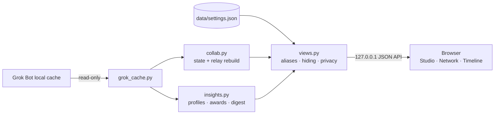

<div align="center">


# grokbot-teamwork-UI

**Bot Office** — your Grok Bot team, as a living office

See what every bot is doing, who handed what to whom, and every leg a task took from your message to the final reply.

[](./LICENSE)


[中文](./README.md) · **English**

[Quick start](#quick-start) · [Features](#features) · [Settings](#settings--customization) · [How it works](#how-it-works) · [FAQ](#faq)


<sub>Screenshots use the built-in demo team — no real conversations.</sub>

</div>

---

## Why

Bots in Grok Bot hand work to each other: a lead bot splits a task, passes pieces to a researcher, a writer and an archivist, then reports back to you. Those handoffs are scattered across each bot's transcript, so the big picture is hard to see.

Bot Office reads the cache Grok Bot keeps on your machine, stitches the handoffs back into complete relays, and acts them out in a small animated office. It is inspired by [Star-Office-UI](https://github.com/ringhyacinth/Star-Office-UI), and goes beyond status to focus on **how bots work together**.

## Highlights

- **Collaboration you can see**: on a handoff the sender walks over, says the first line of the message, passes a winged letter, and the receiver answers “Got it!” before the sender walks back.
- **Full relays**: follow a task from your message (or a schedule) through every bot that touched it, and replay it leg by leg with pause, step and speed controls.
- **Three views**: Studio (space), Network (who works with whom) and Timeline (how a relay moved through time).
- **Useful insights**: things that need you, a daily digest you can copy as Markdown, a team-rhythm heatmap and a schedule board.
- **Bots you can dress up**: 9 bodies × 13 colours × eyes, mouths, hats, held items and outfits — all SVG.
- **Local and read-only**: listens on `127.0.0.1` only, never writes to Grok Bot's files, never uploads anything; privacy mode hides every message in one click.
- **Zero setup**: Python 3.9+ standard library, no `pip install`, no build step; a demo team lets you try it without Grok Bot.

## Quick start

```bash
git clone https://github.com/Olivia295/grokbot-teamwork-UI.git
cd grokbot-teamwork-UI
./start.sh
```

Your browser opens <http://127.0.0.1:19200>.

| OS | Easiest way |
| --- | --- |
| macOS | double-click `start.command` |
| Windows | double-click `start.bat` |
| Linux / anything | `python3 backend/server.py --open` |

```bash
python3 backend/server.py --demo        # demo team only: screenshots, trying it out, no Grok Bot installed
python3 backend/server.py --port 8080   # different port
```

Bot Office looks for Grok Bot's data here:

| OS | Default location |
| --- | --- |
| macOS | `~/Library/Application Support/Grok Bot` |
| Windows | `%APPDATA%\Grok Bot` |
| Linux | `~/.config/Grok Bot` |

If yours lives elsewhere, set it in **Settings → Data source** or via the `GROK_BOT_SUPPORT` environment variable. When no data is found the page switches to demo mode and says so at the top.

## Features

### Studio: bots at work


- Each Grok sidebar group is a room. More groups wrap onto new rows and busy rooms grow taller. Bots without a group get an “Ungrouped” room; pinned bots sit at the front desk.
- Busy bots sit at their desks, idle ones relax in the lounge, and long-quiet ones doze off. The icon above each head is its status: gear = working, check = just wrote, dots = reading, envelope = handing off, ! = stuck, z = asleep.
- Requests from you show “You” walking over; when a bot replies, it comes to find you in the hallway.
- When nothing is happening the stage replays recent relays and regular partners drop by each other; a new handoff pops a toast and is acted out live.

### Network & Timeline

- **Network**: a relationship map weighted by handoffs. Thicker lines mean more handoffs, dots flow in the handoff direction, and groups cluster together.
- **Timeline**: one row per bot, time runs right, each coloured thread is one relay. Replay turns it into a step-by-step sequence.

### Relays, Partners, Activity

- **Relays**: every relay's origin (you / a schedule / a bot), who it passed through and how long it took. Open one to replay it on the stage: space pauses, ← → steps, 1× / 2× / 4× speed.
- **Partners**: which pairs work together most, who hands work to whom, one-way or two-way, and their latest message — replay that exact leg in one click.
- **Activity**: a timeline of handoffs, replies, requests and schedule changes.

### Insights


- **Needs you**: bots waiting for your reply, unread messages, bots that hit an error, relays running too long.
- **Daily digest**: today vs yesterday — outputs, handoffs, your requests, active bots, the busiest bot, the best duo, active hours. Copy it as Markdown for your team chat.
- **Team rhythm**: a weekday × hour heatmap of when the team is busiest.
- **Schedules**: every scheduled task across all bots, with deleted ones folded away.

### Achievements & profiles

- **Achievements**: Chatterbox, Dispatcher, Go-to teammate, Connector, Quick draw, Night owl, Early bird, Alarm lover, New hire.
- **Profiles**: level and XP, two-week output, busiest hour, reply speed, regular partners, schedules, recent relays — and a one-click “Change look”.

### Compared with Star-Office-UI

| | Star-Office-UI | Bot Office |
| --- | --- | --- |
| Data | Agents push their status | Reads Grok Bot's local cache, no changes to your bots |
| Focus | What each agent is doing now | Also who handed what to whom, as full relays |
| Replay | — | Leg-by-leg replay with speed and stepping, in three views |
| Analysis | Yesterday's memo | Daily digest, rhythm heatmap, needs-you list, partners, achievements, levels |
| Characters | Pixel art assets with swappable backgrounds | Mix-and-match SVG kit (body, colour, face, hat, held item, outfit) |
| Runtime | Flask | Standard library only, zero dependencies |

## Settings & customization

Open settings from the gear at the top right. Everything is saved to `data/settings.json` on your machine (git-ignored).

| Section | What you can do |
| --- | --- |
| General | Language (system / 中文 / English), theme, default time range, refresh rate, animation level, auto replay |
| Privacy | Privacy mode hides every message and bot description, keeping only who works with whom — for screenshots and screen sharing |
| Data source | Automatic / Grok Bot only / demo, plus a custom data folder |
| Rooms | Rename, reorder or hide rooms |
| Bots & looks | Give a bot an alias, hide it from the office, change its look (live preview in five states) |


### Avatar kit

Each bot is assembled from swappable parts. The default look comes from its Grok avatar shape, colour and role; override any part:

| Part | Options |
| --- | --- |
| Body | Dumpling, Bean, Sugar cube, Cloud, Droplet, Ghostie, Kitty, Bear, Bunny |
| Colour | Peach, Tangerine, Lemon, Matcha, Mint, Sky, Ocean, Lavender, Grape, Sakura, Cocoa, Charcoal, Cloud white |
| Eyes | Dots, Sparkly, Happy, Sleepy, Wink, Glasses |
| Mouth | Smile, Cat, Laugh, Tiny, Oh |
| Hat | Crown, Beanie, Cap, Headphones, Bow, Sprout, Wizard, Beret, Halo, Antenna, Party hat |
| Holding | Laptop, Book, Pencil, Magnifier, Coffee, Light bulb, Dice, Clipboard, Brush |
| Outfit | Scarf, Bow tie, Tie, Badge, Apron |

### Extending it

- **Add a language**: copy the `en` block in `frontend/js/i18n.js`, translate it, and add an option to the language picker in `frontend/settings.html`.
- **Add an avatar part**: add its name to the `AV` catalog in `frontend/js/avatars.js`, draw it in `hatArt` / `itemArt` / `outfitArt`, and name it in `i18n.js`.
- **Change default looks**: `ROLE_PARTS` in `avatars.js` matches bot names and roles to hats and held items.

## How it works



A handoff is recorded twice: the sender's transcript gets a reply with `toAgent`, the receiver's gets a message with `fromAgent`, at almost the same moment; entries sharing a `requestId` belong to one turn. Pairing the two copies lets Bot Office follow a task from your message through every bot that touched it, up to the reply you received. When the receiver's cache has no matching record, that leg is marked as untraced.

### Privacy & security

- The server binds to `127.0.0.1` only and rejects API calls from other hosts or origins.
- It only reads Grok Bot's cache, never writes to it, and calls no outside service.
- Settings are written only to `data/settings.json` inside the project.
- In privacy mode, message text is replaced on the server before it ever reaches the page.

## Project layout

```text
backend/
  server.py      local HTTP server (--port / --demo / --open)
  grok_cache.py  reads Grok Bot's cache, finds the folder on each OS
  collab.py      office state and relay reconstruction
  insights.py    profiles, achievements, activity, digest, rhythm
  views.py       picks the data source and applies your settings
  settings.py    reads, validates and writes data/settings.json
  demo.py        the demo team
frontend/
  index.html  settings.html  css/app.css
  js/  i18n.js · avatars.js · common.js · stage.js · panels.js · main.js · settings.js
tests/           unit tests
docs/            logo and screenshots
start.sh · start.command · start.bat
```

## Development

```bash
python3 -B -m unittest discover -s tests -v     # backend tests
python3 backend/server.py --demo --open          # work against demo data
```

There is no build step — edit and refresh. GitHub Actions runs the tests on macOS, Windows and Linux with Python 3.9 and 3.12.

## FAQ

<details>
<summary><b>The page says “Demo data”</b></summary>

No Grok Bot cache was found. Open Grok Bot and sign in once, or set the folder in Settings → Data source.
</details>

<details>
<summary><b>Port already in use</b></summary>

`python3 backend/server.py --port 19201`, or close the copy that is already running.
</details>

<details>
<summary><b>I want to share a screenshot without showing conversations</b></summary>

Turn on privacy mode in Settings — every message and bot description is hidden. Or start with `--demo`.
</details>

<details>
<summary><b>Some handoffs say “no follow-up found on the receiving side”</b></summary>

The receiving bot's transcript isn't in the local cache (for example, you haven't opened it in a while). Open that bot in Grok Bot once to sync it.
</details>

## Contributing

Issues and pull requests are welcome — new avatar parts, new languages and new insight cards especially. Please run the tests first, and keep the ground rule: read-only, local only.

## Credits & license

- Inspired by [Star-Office-UI](https://github.com/ringhyacinth/Star-Office-UI).
- Code is [MIT](./LICENSE) licensed; every character, scene and icon is SVG shipped with the project.
- Grok is a trademark of xAI. This is a community project and is not affiliated with xAI.
