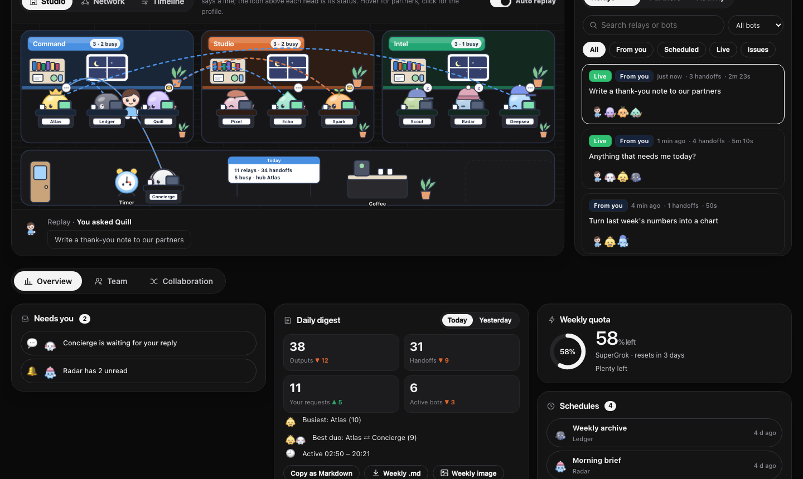
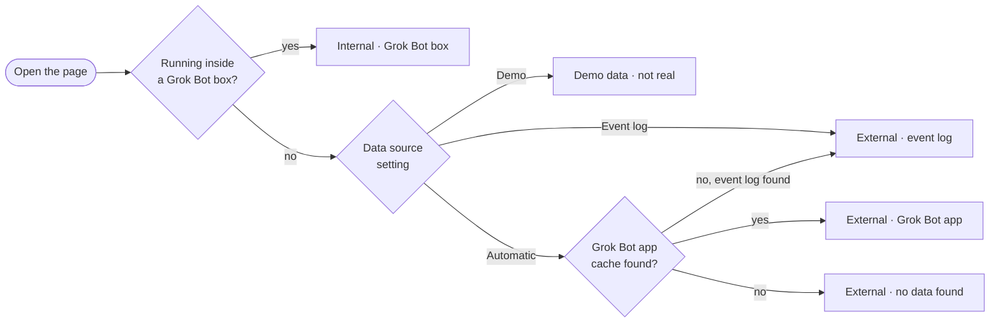
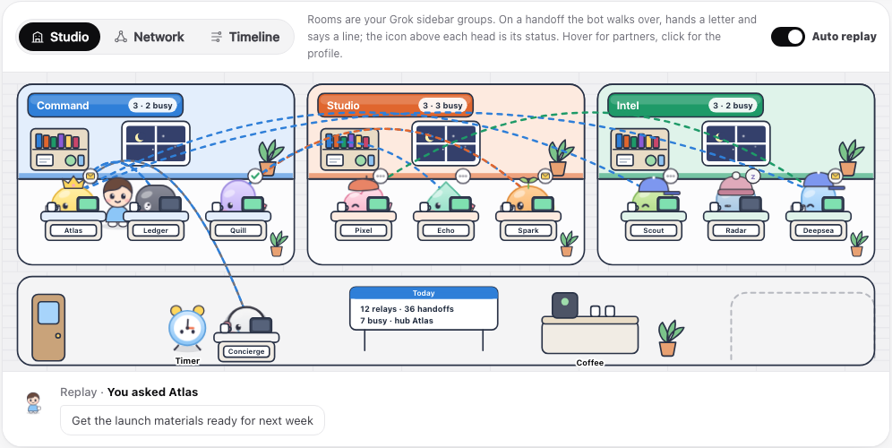
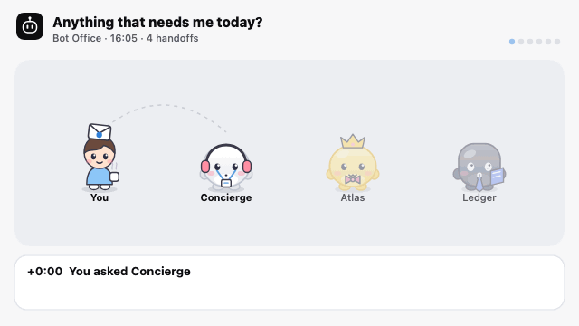
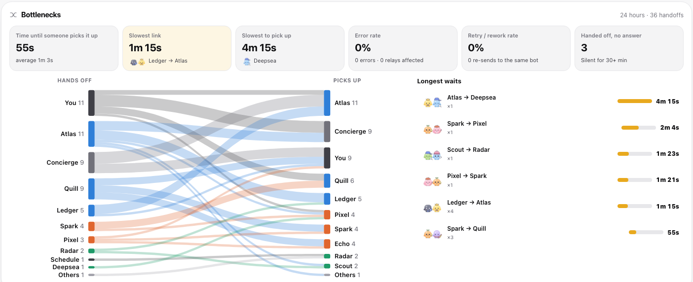
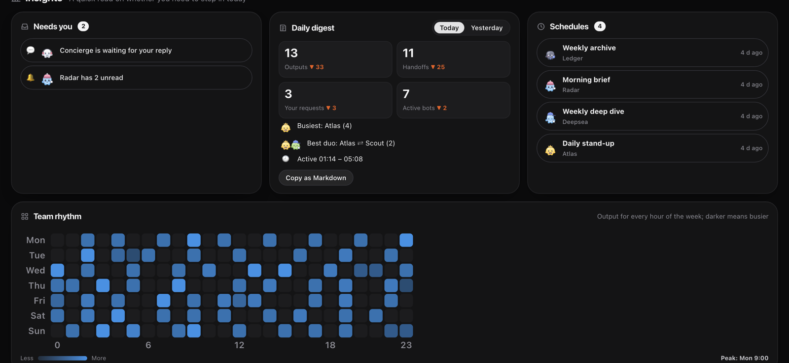
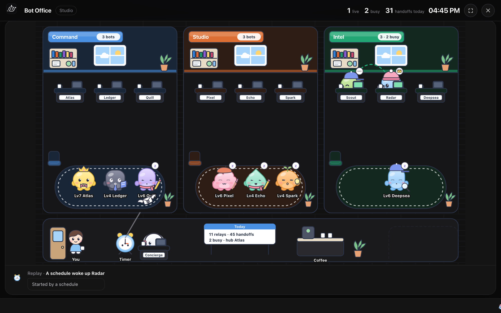
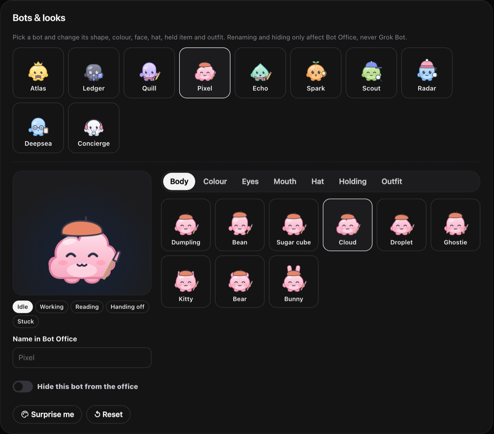
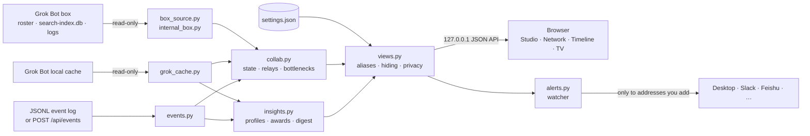

<div align="center">


# grokbot-team-monitor-UI

**Bot Monitoring Room**: your Grok Bot team, or any multi-agent system, as a living office

See what every bot is doing, who handed what to whom, where work gets stuck, and every leg a task took from your message to the final reply.

[](https://olivia295.github.io/grokbot-team-monitor-UI/)
[](./LICENSE)


**English** · [中文](./README.zh-CN.md)

[Live demo](https://olivia295.github.io/grokbot-team-monitor-UI/) · [What's new](#whats-new-in-060) · [Real data](#real-data-clearly-labelled) · [Quick start](#quick-start) · [Features](#features) · [Any agent system](#any-multi-agent-system) · [Grok Bot box](#inside-the-grok-bot-box) · [Settings](#settings--customization) · [FAQ](#faq)



<sub>Screenshots use the built-in demo team, with no real conversations.</sub>

</div>

---

## Why

Bots in Grok Bot hand work to each other. A lead bot splits a task, passes pieces to a researcher, a writer and an archivist, then reports back to you. Those handoffs are scattered across each bot's transcript, so the big picture is hard to see.

Bot Monitoring Room reads the cache Grok Bot keeps on your machine, stitches the handoffs back into complete relays, and acts them out in a small animated office. Other agent frameworks can join through a one-line-per-event log. It is inspired by [Star-Office-UI](https://github.com/ringhyacinth/Star-Office-UI), but goes beyond status to show **how bots work together, and where that work slows down**.

## Highlights

- **Collaboration you can see**: on a handoff, the sender walks over, says the first line of the message and passes a winged letter, then walks back. Bubbles only ever show recorded messages; nothing is scripted.
- **Full relays**: follow a task from your message (or a schedule) through every bot that touched it. Replay it leg by leg, search it, link to it, or export it as a GIF.
- **Bottleneck analysis**: how long each handoff waits, the slowest link, error and retry rates, and a Sankey chart of where work flows.
- **Alerts**: desktop notifications, Slack, Discord, Feishu or DingTalk when a bot errors, waits on you, or leaves a handoff hanging, even with the page closed.
- **Made to share**: weekly reports as Markdown or an image, a big-screen mode for the office TV, and a transparent overlay for streams.
- **Works beyond Grok**: CrewAI, LangGraph, the OpenAI Agents SDK or your own scripts can feed the same office through a simple JSONL event log.
- **Two ways to read Grok Bot**: from your computer (the Grok Bot app's cache), or from inside the Grok Bot box itself, which adds each bot's work status, recent tasks, real message counts and who dispatches whom.
- **Only real data, always labelled**: the header says whether the page reads internally, externally or shows the demo, and the footer says when the data last changed. Nothing found means an empty office, not a stand-in team.
- **Local and read-only**: it listens on `127.0.0.1` only, never writes to Grok Bot's files, and uploads nothing. Alerts go only to the addresses you add, and privacy mode hides every message in one click.
- **Zero setup**: Python 3.9+ standard library only, with no build step. Try the [online demo](https://olivia295.github.io/grokbot-team-monitor-UI/) with a guided tour, nothing to install, or start a local copy with `--demo`.

## What's new in 0.6.0

A new name, and one page built around the studio: what's happening now on top, details in tabs below.

| | Update | Where |
| --- | --- | --- |
| 🏷 | **New name**: Bot Monitoring Room (Bot监控室), repository `grokbot-team-monitor-UI`, command `bot-monitor`. The old `bot-office` command, `bot_office` client import, `BOT_OFFICE_*` variables and settings folder keep working | [Quick start](#quick-start) |
| 🏢 | **Studio first, for both reading modes**: a one-line status strip, then the studio and relay list, then tabs | Top of the page |
| 🪑 | **A tidier studio**: every bot keeps its own desk (idle ones rest there instead of crowding a lounge), rooms are only as tall as their desks, no overlapping name tags, and a lone "Ungrouped" room keeps normal width | Studio |
| 🗂 | **Tabs instead of one long page**: Overview, Team, Collaboration, and Host on a Grok Bot box. Remembered per browser and linkable as `#tab=team` | Under the studio |
| 📈 | **Status board on the box** (Overview): all-clear or alert banner, KPI cards compared with yesterday and the 7-day average, hourly message chart. Missing data says "no data", never a guess | Overview tab |
| 👥 | **One team table on the box** (Team): status, file activity, messages sent / received, a 24-hour activity strip and recent tasks, in one row per bot. Click a name for the profile | Team tab |
| 🖥 | **Host tab**: uptime, load, memory, disk, local services with response times, and Tailscale devices, read-only | Host tab |
| 🔧 | **Services you choose**: Settings → Local services lists what the Host tab checks; empty means common services that are running | Settings → Local services |
| 🧹 | **Nothing shown twice**: the separate who-dispatched-whom table is gone (the Sankey and Partners show it), the box's summary card folds into the team table's header, and on a box the digest drops the numbers the status board already compares with yesterday | Everywhere |
| 🔌 | **Default port 10000** (was 19200) | `--port` to change |

<details>
<summary><b>What came in 0.5.0</b></summary>

This release is about trust: every number on the page is real, and the page always says where it came from.

| | Update | Where |
| --- | --- | --- |
| 🌐 | **Online demo with a guided tour**: a made-up team that always looks live, a 9-stop tour of what each part of the page does (reopen it with **?**), demo alerts found by the real alert rules, and a sample Grok Bot box panel. Nothing to install | [olivia295.github.io/grokbot-team-monitor-UI](https://olivia295.github.io/grokbot-team-monitor-UI/) |
| 🗒 | **Recent tasks in a pop-up**: in the box panel, click a bot's task count to open its duty and recent tasks with dates, instead of a cramped inline list | Box panel |
| ✨ | **Usability pass**: no sideways scrolling on phones, the tour's bottom sheet on small screens, English text for English readers in the box panel, hidden empty counters, shorter labels | Everywhere |
| 🏷 | **Read mode in the header**: *Internal · Grok Bot box*, *External · Grok Bot app online / closed*, *External · event log*, *Demo data · not real* or *External · no data found* | Header pill · Settings → Data source |
| 🕒 | **Data freshness**: the footer shows when the underlying data last changed (from the cache, event log or box files), not just when the page refreshed | Footer |
| 🚫 | **No automatic demo team**: with nothing to read, the office stays empty and says so. The demo appears only with `--demo` or Settings → Data source → Demo | [Real data](#real-data-clearly-labelled) |
| 🗄 | **Grok Bot box reading**: run Bot Monitoring Room inside the box to read its roster, message index and dispatch log. On a box it always reads the box, with no external switch to get wrong | [Inside the Grok Bot box](#inside-the-grok-bot-box) |
| 📊 | **Real counts on the box**: 7-day messages sent and received per bot, replies to you, handoffs and reply times all come from the message index. The old activity *estimate* is gone. Avatars and titles come from each bot's `profile.json` | Box panel · Insights |
| 🗂 | **Clearer file-activity labels**: *Files changed today / in 3 days / earlier* instead of *Active / Recent / Idle*, which looked like online status | Box panel |
| 💬 | **No scripted lines**: speech bubbles show the recorded message, and partner visits show the real handoff count (🤝 ×N) | Studio |
| — | **"—" when a mode can't measure something**: no made-up zeros. The quota card only shows where quota exists (the Grok Bot app cache) | Hero tiles · quota card |
| 🔓 | **Opens directly on your own network**: host names in `BOT_OFFICE_ALLOWED_HOSTS` open without a token. `BOT_OFFICE_TOKEN` is now opt-in | [Opening the box's office from elsewhere](#opening-the-boxs-office-from-elsewhere) |

</details>

<details>
<summary><b>What came in 0.4.0</b></summary>

| | Update | Where |
| --- | --- | --- |
| 🌐 | **Online demo**: the whole app on GitHub Pages with a looping, always-live demo team | [Live demo](https://olivia295.github.io/grokbot-team-monitor-UI/) |
| 🔔 | **Alerts**: desktop notifications and Slack / Discord / Feishu / DingTalk / generic webhooks when a bot errors, waits for you or a handoff goes unanswered. Includes quiet hours, cooldowns and a test button | Settings → Alerts · 🔔 in the header |
| 🔌 | **Event adapter**: any multi-agent system can appear in the office via a JSONL log or `POST /api/events`, with a Python helper and recipes | [docs/events.md](docs/events.md) |
| 🧭 | **Bottlenecks**: pickup time per handoff, slowest link and teammate, error, retry and no-answer rates, plus a Sankey chart. Click a slow link to list its relays | Insights → Bottlenecks |
| 🔎 | **Search & deep links**: search relays by text or bot, filter to relays with issues, and share `#flow=…` links that open straight into a replay | Relay list · replay bar |
| 📤 | **Export & share**: weekly report as Markdown or PNG, and any relay replay as an animated GIF | Daily digest card · replay bar |
| 📦 | **Easier install**: `pipx` / `uvx`, a Homebrew formula with `brew services`, and a macOS menu-bar app that starts at login | [Quick start](#quick-start) |
| 📺 | **Big screen & overlay**: full-screen TV mode that rotates views with a live ticker, and a transparent OBS overlay | 📺 in the header · `?tv=1` · `?overlay=1` |

</details>

## Real data, clearly labelled

Bot Monitoring Room never fills gaps with invented data. The header pill tells you which source you're looking at:

| Pill | What you're seeing |
| --- | --- |
| **Internal · Grok Bot box** | Read inside the Grok Bot box from its roster, message index and logs |
| **External · Grok Bot app online** / **closed** | Read from the Grok Bot app's cache on this computer. When the app is closed, it's the last state the app saved |
| **External · event log** | Read from a JSONL event log (any agent system) |
| **Demo data · not real** | The built-in demo team, only when you ask for it |
| **External · no data found** | Nothing to read yet, so the office is empty |



- The footer reads like *Read-only · checked 09:38 · data last changed 3 min ago*. The time comes from the data files themselves.
- A number a source can't measure shows **—**, not 0. The quota card appears only where quota exists, and box mode shows bot outputs instead of characters written.
- Speech bubbles show the start of the real message. When a source kept no text for a message, you see "…" instead of a made-up line.

## Quick start

```bash
git clone https://github.com/Olivia295/grokbot-team-monitor-UI.git
cd grokbot-team-monitor-UI
./start.sh
```

Your browser opens <http://127.0.0.1:10000>.

| OS | Easiest way |
| --- | --- |
| macOS | double-click `start.command` |
| Windows | double-click `start.bat` |
| Linux / anything | `python3 backend/server.py --open` |

### Install it as a command

```bash
pipx install git+https://github.com/Olivia295/grokbot-team-monitor-UI.git
bot-monitor --open

# or run it once without installing
uvx --from git+https://github.com/Olivia295/grokbot-team-monitor-UI.git bot-monitor --open
```

Installed copies keep their settings in your user folder (`~/Library/Application Support/Bot Monitoring Room` on macOS, `%APPDATA%\Bot Monitoring Room` on Windows, `~/.config/bot-monitor` on Linux).

**Homebrew**: [`packaging/homebrew/grokbot-team-monitor-ui.rb`](packaging/homebrew/grokbot-team-monitor-ui.rb) is ready for a tap. Once it is published there, use `brew install Olivia295/tap/grokbot-team-monitor-ui`, then `brew services start grokbot-team-monitor-ui` to keep it running from login.

**macOS menu-bar app**: `./packaging/macos/build-app.sh` builds `Bot Monitoring Room.app` (needs the Xcode command line tools). It starts the server for you and shows the number of busy bots in the menu bar. Its menu lists live relays and the latest alert, opens the office, big-screen mode or settings, and can start at login.

### Options

```bash
bot-monitor --demo                   # demo team only: screenshots, trying it out, no Grok Bot installed
bot-monitor --events runs.jsonl      # read another agent system's event log (see below)
bot-monitor --port 8081              # different port
bot-monitor --open --tv              # open straight into big-screen mode
```

(From a checkout, `python3 backend/server.py` takes the same options.)

Bot Monitoring Room looks for Grok Bot's data here:

| OS | Default location |
| --- | --- |
| macOS | `~/Library/Application Support/Grok Bot` |
| Windows | `%APPDATA%\Grok Bot` |
| Linux | `~/.config/Grok Bot` |

If yours lives elsewhere, set it in **Settings → Data source** or with the `GROK_BOT_SUPPORT` environment variable. When no data is found, the page uses an event log if you have one; otherwise it stays empty and says so at the top. The demo team only appears when you ask for it (`--demo`, or Settings → Data source → Demo).

## Features

### Studio: bots at work



- Each Grok sidebar group (or `team` in an event log) is a room. Rooms sit three to a row at one width and are only as tall as their desks. Bots without a group get an "Ungrouped" room, and pinned bots sit at the front desk.
- Every bot keeps its own desk: busy ones work, idle ones rest there a little dimmed, and long-quiet ones doze off. The icon above each head shows status: gear = working, check = just wrote, dots = reading, envelope = handing off, ! = stuck, z = asleep.
- Requests from you show "You" walking over. When a bot replies, it comes to find you in the hallway.
- When nothing is happening, the stage replays recent relays and regular partners drop by each other. A new handoff pops a toast and is acted out live.

### Network & Timeline

- **Network**: a relationship map weighted by handoffs. Thicker lines mean more handoffs, dots flow in the handoff direction, and groups cluster together.
- **Timeline**: one row per bot, with time running right. Each coloured thread is one relay, and replay turns it into a step-by-step sequence.

### Relays: search, replay, share

- **Relays**: every relay's origin (you, a schedule or a bot), who it passed through and how long it took. Search by message text or bot name, filter by bot, and use **Issues** to see only relays with errors, retries or untraced legs.
- **Replay** a relay on the stage: space pauses, ← → steps, 1× / 2× / 4× speed. Each leg shows how long the receiver took to pick it up, and whether it failed or was a retry.
- **Share**: the address becomes `#flow=<id>` while a replay runs, so copying it (🔗 in the replay bar) gives a link that opens straight into that relay. 🎞 exports the replay as an animated GIF:



- **Partners**: which pairs work together most, who hands work to whom, one-way or two-way, and their latest message. Replay that exact leg in one click.
- **Activity**: a timeline of handoffs, replies, requests and schedule changes.

### Bottlenecks



- **Pickup time**: for every handoff, how long until the receiver produced anything, as a median and an average.
- **Slowest link** and **slowest teammate**: the hand-over pair and the bot where work waits longest (pairs seen more than once count first, so one bad afternoon doesn't dominate).
- **Error rate**, **retry / rework rate** (the same bot handed the same work again within a relay) and **handed off, no answer** (silent for 30+ minutes).
- **Sankey**: work entering from you and schedules, flowing between bots and coming back to you. Hover a band for its count and average wait.
- **Longest waits**: click any slow link to list just the relays that went through it.

### Alerts

The local server watches for trouble even when the page is closed:

| When | Example |
| --- | --- |
| A bot hits an error | "Scout ran into a problem" |
| A bot is waiting for your reply | "Concierge is waiting for your reply" |
| Nobody picks up a handoff for N minutes | "Deepsea hasn't picked up Pixel's handoff · Waiting for 12 min" |
| A relay finishes (optional) | "Atlas finished a relay" |

Send alerts to a **desktop notification** (macOS, Windows, Linux with `notify-send`) and any number of **webhooks**: Slack, Discord, Feishu / Lark, DingTalk (with optional signing) or generic JSON. Each message links back to the relay. Quiet hours, a cooldown and a **Send a test alert** button are in Settings → Alerts. The 🔔 in the header lists recent alerts.

### Tabs: Overview, Team, Collaboration, Host



Everything below the studio is in tabs, one at a time. The choice is remembered, and `#tab=collab` links straight to a tab.

| Tab | On your computer (external) | On a Grok Bot box (internal) |
| --- | --- | --- |
| **Overview** | Needs you, daily digest and weekly report, weekly quota, schedules | Status board (banner, KPIs, hourly chart), needs you, daily digest |
| **Team** | Team cards and achievements | One table per bot (status, file activity, messages, 24 h strip, recent tasks) and achievements |
| **Collaboration** | Bottlenecks and Sankey, team rhythm | The same: bottlenecks and Sankey, team rhythm |
| **Host** | — | Uptime, load, memory, disk, services, Tailscale devices |

- **Needs you**: bots waiting for your reply, unread messages, bots that hit an error, relays running too long.
- **Daily digest**: today vs yesterday, covering outputs, handoffs, your requests, active bots, the busiest bot, the best duo and active hours. Copy it as Markdown, or export the **weekly report** as a `.md` file or a shareable PNG card.
- **Team rhythm**: a weekday × hour heatmap of when the team is busiest.
- **Schedules**: every scheduled task across all bots, with deleted ones folded away.

### Big screen & stream overlay



- **Big screen** (📺 in the header, `?tv=1`, or `bot-monitor --open --tv`): full screen with no buttons. It rotates Studio → Network → Timeline → Bottlenecks, with live counts, a clock and a ticker of the latest activity. It waits for a live handoff to finish before switching, and hides the cursor. Customise it with `?tv=1&rotate=30&views=studio,neck`.
- **Stream overlay** (`?overlay=1&view=studio`): a transparent background with only the stage, for an OBS browser source.

### Achievements & profiles

- **Achievements**: Chatterbox, Dispatcher, Go-to teammate, Connector, Quick draw, Night owl, Early bird, Alarm lover, New hire.
- **Profiles**: level and XP, two-week output, busiest hour, reply speed, regular partners, schedules, recent relays, and a one-click "Change look".

### Compared with Star-Office-UI

| | Star-Office-UI | Bot Monitoring Room |
| --- | --- | --- |
| Data | Agents push their status | Reads Grok Bot's local cache with no changes to your bots, or any system's JSONL event log |
| Focus | What each agent is doing now | Also who handed what to whom, as full relays |
| Replay | — | Leg-by-leg replay in three views, searchable, linkable, exportable as GIF |
| Analysis | Yesterday's memo | Bottlenecks and Sankey, daily digest and weekly report, rhythm heatmap, needs-you list, partners, achievements |
| Notifications | — | Desktop, Slack, Discord, Feishu, DingTalk, webhooks |
| Display | Browser page | Page, big-screen TV mode, OBS overlay, menu-bar app, online demo with a guided tour |
| Characters | Pixel-art assets with swappable backgrounds | Mix-and-match SVG kit (body, colour, face, hat, held item, outfit) |
| Runtime | Flask | Standard library only, zero dependencies |

## Any multi-agent system

Write one JSON object per line and Bot Monitoring Room shows it like a Grok team: rooms, relays, replays, bottlenecks and alerts.

```jsonl
{"type":"bot","id":"planner","name":"Planner","team":"Core","shape":"cat","color":"lemon"}
{"type":"ask","to":"planner","text":"Fix the login timeout","run":"r42"}
{"type":"handoff","from":"planner","to":"coder","text":"Repro and fix the session timeout","run":"r42"}
{"type":"reply","from":"planner","text":"Fixed and reviewed.","run":"r42"}
```

```bash
bot-monitor --events runs.jsonl --open
# or stream into a running office:
curl -X POST http://127.0.0.1:10000/api/events -H 'Content-Type: application/json' \
  -d '{"type":"handoff","from":"planner","to":"coder","text":"Fix the login bug"}'
```

The full format (`ask`, `handoff`, `reply`, `error`, `status`, `schedule`, `bot`), a drop-in Python client ([`integrations/bot_monitor.py`](integrations/bot_monitor.py)) and recipes for the OpenAI Agents SDK, LangGraph and CrewAI are in **[docs/events.md](docs/events.md)**. To watch it work right away, run `python3 examples/simulate_events.py --post --live`.

## Inside the Grok Bot box

Bot Monitoring Room can also run **inside the Grok Bot box** (the machine your bots work on). There it reads the box's own files instead of the app cache on your computer, and the header pill reads **Internal · Grok Bot box**. On a box there's no external switch: the box has no app cache, so "external" could only ever be the demo team.

| | Box reading (internal) | External reading (your computer) |
| --- | --- | --- |
| Where it runs | Inside the Grok Bot box | The computer with the Grok Bot app |
| Bots and rooms | `/workspace/roster.md` (names, labels, duties, sidebar groups) | The app's roster and sidebar groups |
| Handoffs | `search-index.db` messages (read-only) and `dispatch-log.md` | `toAgent` / `fromAgent` in cached transcripts |
| Coverage | Every bot in the message index, including ones you haven't opened lately | Bots whose transcripts the app has cached |
| Extra tabs | Status board, one team table (file activity, recent tasks, **real** 7-day message counts, 24 h activity), Host | — |
| Weekly quota | Not available on the box (the panel says so, and the quota card is hidden) | **Real** percentage, plan and reset date |
| Message text | Short handoff titles only. Your own messages keep only time and recipient | Full text (hide it with privacy mode) |

- **When it switches on**: internal reading is used whenever both `/workspace/roster.md` and `/home/box/agent-data` exist. `BOT_OFFICE_INTERNAL=1` forces it on and `=0` forces it off. The page, alerts, the big screen and the menu-bar app all read the same source. Off the box, `/api/internal` answers 403.
- **Status board** (Overview): an all-clear / alert banner, KPI cards (bots online, messages, handoffs, reply time, host, failures) compared with the same window yesterday and the 7-day average, and an hourly message chart for 24 hours or 7 days. Unreadable metrics say "no data".
- **Team table** (Team): per bot, when its files last changed (*today*, *in 3 days*, *earlier*), files changed in 7 days, messages sent / received in 7 days, a 24-hour activity strip, and recent tasks from its log (click the count to open them). Counts are `COUNT(*)` queries; message bodies are never selected.
- **Host** (Host tab): uptime, load, memory, `/home/box` disk, local services with response times, and Tailscale devices, collected read-only like the old grok-bot status page. Click a service's name to open it: the link uses the address you opened this page with plus the service's port (for example `http://grok-bot:8888/`), or a URL you set for it. Choose the services in **Settings → Local services**; with none set, JupyterLab 8888, MessageHub 8090 and Blog 4000 are listed when they're running. Off the box, `/api/host-status` answers 403.
- **What it never reads**: Notion Nexus `inbox` / `snapshots` / `raw`, `~/.codex`, `~/.grok`, `auth.json`, anything with `token` in its name, `*.env`, and files named 周记 / 日记. Willow Mage shows only its name and "not monitored". Handoff titles that look personal are replaced with "(hidden)". The SQLite index is opened read-only (`mode=ro`).
- **No demo stand-ins**: with no records yet, the box view says "No box collaboration records yet" instead of showing the demo team.

### Opening the box's office from elsewhere

The server only listens on `127.0.0.1`. If the box exposes it through a proxy or tunnel (for example Tailscale, as `http://grok-bot:10000`), list that host name in `BOT_OFFICE_ALLOWED_HOSTS` (comma-separated), and the page opens there directly.

Anyone who can reach that address can see the box's data. On your own Tailscale network that's usually just your devices. To lock it down further, set `BOT_OFFICE_TOKEN` to a long random string. Requests through the allowed names then need it once: open the page with `?token=…` and it's kept as a cookie, or have scripts send `Authorization: Bearer <token>`. Opening it from the box itself (or through an SSH tunnel to `127.0.0.1`) never needs a token.

## Settings & customization

Open settings from the gear at the top right. Everything is saved on your machine: `data/settings.json` in a checkout (git-ignored), or your user folder when installed.

| Section | What you can do |
| --- | --- |
| General | Language (system / 中文 / English), theme, default time range, refresh rate, animation level, auto replay |
| Privacy | Privacy mode hides every message and bot description, keeping only who works with whom. Useful for screenshots and screen sharing |
| Data source | Reading mode (automatic / Grok Bot box / external), source (automatic / Grok Bot / event log / demo), a custom Grok Bot folder and the event-log path |
| Alerts | What to alert on, wait threshold, cooldown, quiet hours, desktop notifications, webhooks, test button |
| Local services | On a Grok Bot box: the services the Host tab checks (name and port) |
| Big screen & streaming | Time per view, big-screen and overlay URLs to copy |
| Rooms | Rename, reorder or hide rooms |
| Bots & looks | Give a bot an alias, hide it from the office, change its look (live preview in five states) |



### Avatar kit

Each bot is assembled from swappable parts. The default look comes from its Grok avatar shape, colour and role, or from `shape` / `color` in an event log. You can override any part:

| Part | Options |
| --- | --- |
| Body | Dumpling, Bean, Sugar cube, Cloud, Droplet, Ghostie, Kitty, Bear, Bunny |
| Colour | Peach, Tangerine, Lemon, Matcha, Mint, Sky, Ocean, Lavender, Grape, Sakura, Cocoa, Charcoal, Cloud white |
| Eyes | Dots, Sparkly, Happy, Sleepy, Wink, Glasses |
| Mouth | Smile, Cat, Laugh, Tiny, Oh |
| Hat | Crown, Beanie, Cap, Headphones, Bow, Sprout, Wizard, Beret, Halo, Antenna, Party hat |
| Holding | Laptop, Book, Pencil, Magnifier, Coffee, Light bulb, Dice, Clipboard, Brush |
| Outfit | Scarf, Bow tie, Tie, Badge, Apron |

### Extending it

- **Add a language**: copy the `en` block in `frontend/js/i18n.js` (and the `Object.assign(I18N.en, …)` block at its end), translate it, and add an option to the language picker in `frontend/settings.html`.
- **Add an avatar part**: add its name to the `AV` catalog in `frontend/js/avatars.js`, draw it in `hatArt` / `itemArt` / `outfitArt`, and name it in `i18n.js`.
- **Change default looks**: `ROLE_PARTS` in `avatars.js` matches bot names and roles to hats and held items.
- **Add an alert channel**: add a kind to `webhook_request()` in `backend/alerts.py` and to `HOOK_KINDS` in `backend/settings.py` and `frontend/js/settings.js`.

## How it works



A handoff is recorded twice: the sender's transcript gets a reply with `toAgent`, and the receiver's gets a message with `fromAgent`, at almost the same moment. Entries sharing a `requestId` belong to one turn. Pairing the two copies lets Bot Monitoring Room follow a task from your message through every bot that touched it, up to the reply you received. The time from a handoff to the receiver's first output is the pickup time used in the bottleneck view. When the receiver's cache has no matching record, that leg is marked as untraced. The event adapter turns JSONL events into exactly this shape, so every view works the same for other systems.

The [online demo](https://olivia295.github.io/grokbot-team-monitor-UI/) is the same frontend with no server: `scripts/build_pages.py` records the demo team as JSON frames 30 seconds apart, and the page loops them while moving every timestamp to the present. It also runs the real alert rules over the recording (`alerts.json`) and builds a sample box panel from the demo team's records (`internal.json`), so visitors can see alerts and box reading without a box.

### Privacy & security

- The server binds to `127.0.0.1` only and rejects API calls from other hosts or origins, except host names you list in `BOT_OFFICE_ALLOWED_HOSTS` (optionally protected with `BOT_OFFICE_TOKEN`). Settings and test alerts can only be posted by the page itself, and events only by local scripts or the page.
- It only reads Grok Bot's cache, never writes to it, and calls no outside service, except the alert webhooks you add yourself.
- Settings are written only to your settings file.
- In privacy mode, message text is replaced on the server before it ever reaches the page or an alert.

## Project layout

```text
backend/
  server.py      local HTTP server (--port / --demo / --events / --open / --tv)
  grok_cache.py  reads Grok Bot's cache, finds the folder on each OS
  events.py      generic JSONL event adapter + POST /api/events
  internal_box.py  Grok Bot box: roster, bot folders, work status, privacy rules
  host_status.py   Grok Bot box: uptime, load, memory, disk, services, tailnet
  status_board.py  Grok Bot box: overview KPIs and hourly trends from the message index
  box_source.py    Grok Bot box: message index + dispatch log → relays
  collab.py      office state, relay reconstruction, bottlenecks
  insights.py    profiles, achievements, activity, digest, rhythm
  alerts.py      alert watcher, desktop notifications, webhooks
  views.py       picks the data source and applies your settings
  settings.py    reads, validates and writes settings
  demo.py        the demo team
frontend/
  index.html  settings.html  css/app.css
  js/  i18n.js · avatars.js · common.js · stage.js · panels.js · internal.js · export.js · tv.js · tabs.js · tour.js · main.js · settings.js
integrations/    bot_monitor.py: drop-in Python client for the event log (bot_office.py: the old name)
examples/        simulate_events.py: a fake team to try the event adapter
scripts/         build_pages.py: builds the online demo into site/
packaging/       homebrew/ formula · macos/ menu-bar app
docs/            events.md, logo and screenshots
tests/           unit tests
start.sh · start.command · start.bat · pyproject.toml
```

## Development

```bash
python3 -B -m unittest discover -s tests -v     # backend tests
python3 backend/server.py --demo --open          # work against demo data
python3 scripts/build_pages.py                   # build the online demo into site/
python3 -m http.server -d site 8000              # …and preview it
python3 examples/simulate_events.py --post --live   # feed a running office with fake events
./packaging/macos/build-app.sh                   # build the menu-bar app into dist/
```

There is no build step for the app itself: edit and refresh. GitHub Actions runs the tests on macOS, Windows and Linux with Python 3.9 and 3.12, and builds the static site and the wheel. Every push to `main` publishes the online demo to GitHub Pages. To turn the demo on for a fork, set **Settings → Pages → Source** to "GitHub Actions".

## FAQ

<details>
<summary><b>The page says "External · no data found"</b></summary>

No Grok Bot cache (and no event log) was found, so the office stays empty instead of showing made-up data. Open Grok Bot and sign in once, set the folder in Settings → Data source, or point Bot Monitoring Room at an event log. To look around first, pick Demo in Settings → Data source.
</details>

<details>
<summary><b>Alerts don't arrive</b></summary>

Check that alerts are switched on and use **Send a test alert** in Settings → Alerts, which shows the result for each channel. On macOS, allow notifications for "Script Editor" (that's what posts them) in System Settings → Notifications. With DingTalk keyword checks, add the keyword "Bot Monitoring Room". Alerts need the local server; the online demo only shows demo alerts and never sends any.
</details>

<details>
<summary><b>The footer says the data last changed hours ago</b></summary>

That's the age of the data, not of the page. With the Grok Bot app closed, its cache stops changing; open the app (or let your bots run) and the time catches up. On the box it follows the message index, roster and dispatch log.
</details>

<details>
<summary><b>Port already in use</b></summary>

Run `bot-monitor --port 8081` (or `python3 backend/server.py --port 8081`), or close the copy that is already running.
</details>

<details>
<summary><b>I want to share a screenshot without showing conversations</b></summary>

Turn on privacy mode in Settings to hide every message and bot description. Or start with `--demo`, or share the [online demo](https://olivia295.github.io/grokbot-team-monitor-UI/).
</details>

<details>
<summary><b>Some handoffs say "no follow-up found on the receiving side"</b></summary>

The receiving bot's transcript isn't in the local cache (for example, you haven't opened it in a while). Open that bot in Grok Bot once to sync it.
</details>

## Ideas next

- More languages via community translation files
- Contributing guide, issue templates and a changelog
- Per-room and per-bot alert rules

## Contributing

Issues and pull requests are welcome, especially new avatar parts, languages, alert channels, event-log recipes and insight cards. Please run the tests first, and keep the ground rule: read-only, local only.

## Credits & license

- Inspired by [Star-Office-UI](https://github.com/ringhyacinth/Star-Office-UI).
- Code is [MIT](./LICENSE) licensed. Every character, scene and icon is SVG shipped with the project.
- Grok is a trademark of xAI. This is a community project and is not affiliated with xAI.
