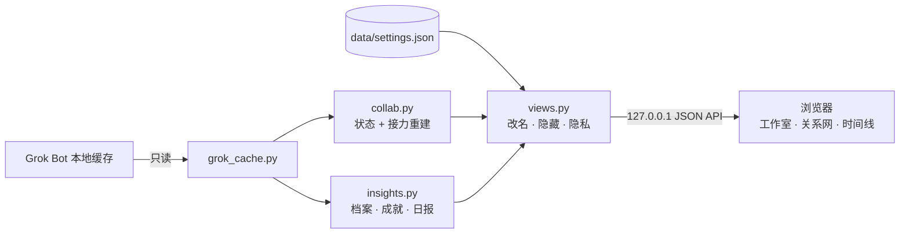

<div align="center">


# grokbot-teamwork-UI

**Bot协作室** —— 把你的 Grok Bot 团队变成一间会动的办公室

看见每个 bot 在忙什么、谁把活交给了谁、一件事从你开口到收到回复经过了哪几棒。

[](./LICENSE)


**中文** · [English](./README.en.md)

[快速开始](#快速开始) · [功能](#功能) · [设置与自定义](#设置与自定义) · [工作原理](#工作原理) · [常见问题](#常见问题)


<sub>截图使用内置演示数据，没有任何真实对话。</sub>

</div>

---

## 为什么做这个

Grok Bot 里的 bot 会互相派活：一个总指挥拆任务，交给搜索、写作、归档的同事，最后再汇总回复你。这些交接散落在各个 bot 的对话记录里，平时很难看出全貌。

Bot协作室读取 Grok Bot 留在本机的缓存，把这些交接拼回完整的接力流程，再用一间会动的办公室把它演出来。灵感来自 [Star-Office-UI](https://github.com/ringhyacinth/Star-Office-UI)，在「看状态」之外，重点放在 **bot 和 bot 之间的协作**。

## 亮点

- **看得见的协作**：交接时，交出方会走到对方身边、说出交接内容的第一句、递过一封带翅膀的信，对方回一句「收到！」再走回去。
- **完整的接力流程**：从你的一句话（或一个定时任务）一路追到每个转手的 bot，可以逐棒回放、暂停、调速。
- **三种视图**：工作室（空间）、关系网（谁和谁配合多）、时间线（一次协作在时间里穿过了谁）。
- **有用的洞察**：需要你处理的事、日报（可复制成 Markdown）、团队作息热力图、定时任务总表。
- **可以打扮的 bot**：9 种身体 × 13 种颜色 × 眼睛、嘴巴、帽子、手持物、服饰，全部是 SVG。
- **只在本机、只读**：只监听 `127.0.0.1`，不改 Grok Bot 的文件，不上传任何数据；隐私模式可以一键隐藏所有消息内容。
- **开箱即用**：Python 3.9+ 标准库，不用 `pip install`，不用构建；没有 Grok Bot 也能用演示团队体验。
- **两种读取**：顶部可切换「Grok Bot 本机读取」和「外部读取」。本机模式在原来的办公室之外，多一块工作状态、协作关系和用量估算；外部模式与原来一致。

## 快速开始

```bash
git clone https://github.com/Olivia295/grokbot-teamwork-UI.git
cd grokbot-teamwork-UI
./start.sh
```

浏览器会自动打开 <http://127.0.0.1:19200>。

| 系统 | 最简单的方式 |
| --- | --- |
| macOS | 双击 `start.command` |
| Windows | 双击 `start.bat` |
| Linux / 任意系统 | `python3 backend/server.py --open` |

```bash
python3 backend/server.py --demo        # 只看演示团队：截图、试玩、没装 Grok Bot 时
python3 backend/server.py --port 8080   # 换端口
```

Bot协作室会自动在这些位置找 Grok Bot 的数据：

| 系统 | 默认位置 |
| --- | --- |
| macOS | `~/Library/Application Support/Grok Bot` |
| Windows | `%APPDATA%\Grok Bot` |
| Linux | `~/.config/Grok Bot` |

不在这里的话，到 **设置 → 数据来源** 填目录，或设置环境变量 `GROK_BOT_SUPPORT`。找不到数据时会自动进入演示模式，页面顶部有提示。

### 读取方式

顶部可以在 **Grok Bot 本机读取** 和 **外部读取** 之间切换，选择记在浏览器里。外部读取就是上面的办公室。本机读取在那之外多一块面板：每个 bot 最近在忙什么、日志里谁提到谁、以及一张标明「估算」的用量图。没有真实限额数据，面板会写明「无真实限额/用量数据」。

本机读取只有在 `/workspace/roster.md` 和目录 `/home/box/agent-data` 都在时才能用，否则该选项禁用。`BOT_OFFICE_INTERNAL=1` 强制打开，`=0` 强制关闭。检测得到本机环境时，默认用本机读取。Willow Mage 只显示「不监控」；不读 Notion 的 `inbox` / `snapshots` / `raw`，不读密钥、周记和日记。

## 功能

### 工作室：bot 在办公室里干活


- Grok 侧边栏的每个分组是一个房间；分组多了自动换行，人多的房间自动变高。没有分组的 bot 进「未分组」房间，钉住的 bot 坐前台。
- 在忙的坐工位，闲着的去休息区，很久没动静的会打瞌睡。头顶图标就是状态：齿轮=在干活、对勾=刚写完、省略号=在读消息、信封=在交接、感叹号=卡住了、z=睡着了。
- 你发起的任务，是「你」亲自走过去交代；bot 回复你时会走到走廊来找你。
- 没有协作发生时，舞台会自动重播最近的接力，最常配合的搭档还会互相串门；新的交接一出现，右上角弹出提示并现场重演。

### 关系网 & 时间线

- **关系网**：按交接次数排出的关系图，线越粗交接越多，光点沿交接方向流动，同组成员聚在一起。
- **时间线**：每行一个成员，时间往右走，每根彩线是一次协作经过的人；点开回放时变成逐棒顺序图。

### 协作流程、搭档、动态

- **协作流程**：每一次接力的起点（你 / 定时任务 / 某个 bot）、经过的人、用时；点开在舞台上逐棒回放，空格暂停、← → 单步、可调 1×/2×/4×。
- **搭档**：哪两个 bot 配合最多、谁给谁派活、单向还是双向、最近一次说了什么，一键回放那一棒。
- **动态**：派活、回复、提问、定时任务变更的时间线。

### 洞察


- **需要你**：在等你回复的 bot、未读消息、出错的 bot、跑了太久的协作。
- **日报**：今天 / 昨天的产出、交接、提问、活跃 bot、最忙的 bot、最佳拍档、活跃时段，和前一天对比；一键复制成 Markdown 发到群里。
- **团队作息**：一周 × 24 小时热力图，看团队什么时候最忙。
- **定时任务总表**：所有 bot 挂着的定时任务，已删除的单独折叠。

### 成就与成员档案

- **本期成就**：话痨王、总调度、人气接棒手、社交达人、快枪手、夜猫子、早起鸟、闹钟控、新同事。
- **成员档案**：等级与经验条、近两周产出、一天里几点最忙、回复速度、常搭档、定时任务、参与过的协作，以及一键「换个造型」。

### 和 Star-Office-UI 的区别

| | Star-Office-UI | Bot协作室 |
| --- | --- | --- |
| 数据来源 | Agent 主动推送状态 | 直接读 Grok Bot 本地缓存，无需改造 bot |
| 关注点 | 每个 agent 现在在做什么 | 还有 bot 之间谁交给了谁、完整接力流程 |
| 回放 | — | 逐棒回放、调速、单步，三种视图 |
| 分析 | 昨日小记 | 日报、作息热力图、需要你、搭档榜、成就、等级 |
| 角色 | 像素美术素材，可替换背景 | 可自由组合的 SVG 角色套件（身体、颜色、表情、帽子、手持、服饰） |
| 运行 | Flask 后端 | 纯标准库，零依赖 |

## 设置与自定义

点右上角齿轮进入设置。所有设置保存在本机的 `data/settings.json`（已加入 `.gitignore`），不会提交到仓库。

| 分组 | 可以做什么 |
| --- | --- |
| 通用 | 语言（跟随系统 / 中文 / English）、深浅色、默认时间范围、刷新频率、动画强度、自动放映 |
| 隐私 | 隐私模式：隐藏所有消息和 bot 介绍，只保留谁和谁在协作，适合截图和投屏 |
| 数据来源 | 自动 / 只用 Grok Bot / 演示数据，自定义数据目录 |
| 房间 | 改显示名称、调整顺序、隐藏房间 |
| 成员与造型 | 给 bot 起别名、在办公室隐藏、换造型（实时预览五种状态） |


### 造型素材

每个 bot 都由可替换的部件组成。默认造型根据它在 Grok 里的头像形状、颜色和职责自动生成，你可以逐项替换：

| 部件 | 选项 |
| --- | --- |
| 身体 | 团子、豆豆、方糖、云朵、水滴、小幽灵、猫猫、小熊、兔兔 |
| 颜色 | 蜜桃、橘子、柠檬、抹茶、薄荷、天空、海洋、薰衣草、葡萄、樱花、可可、炭黑、云白 |
| 眼睛 | 豆豆眼、星星眼、开心、困困、眨眼、眼镜 |
| 嘴巴 | 微笑、猫嘴、大笑、小嘴、哦 |
| 帽子 | 皇冠、毛线帽、棒球帽、耳机、蝴蝶结、小芽、巫师帽、贝雷帽、光环、天线、派对帽 |
| 手持 | 笔记本、书、铅笔、放大镜、咖啡、灯泡、骰子、夹板、画笔 |
| 服饰 | 围巾、领结、领带、工牌、围裙 |

### 动手扩展

- **加一种语言**：在 `frontend/js/i18n.js` 里复制 `en` 整块并翻译，再在 `frontend/settings.html` 的语言下拉框加一项。
- **加一个造型部件**：在 `frontend/js/avatars.js` 的 `AV` 目录加名字，在 `hatArt` / `itemArt` / `outfitArt` 里画出来，再到 `i18n.js` 起中英文名。
- **改默认造型规则**：`avatars.js` 里的 `ROLE_PARTS` 按 bot 名字和职责关键词配帽子和手持物。

## 工作原理



一次交接会在两边各记一笔：交出方的记录里是一条带 `toAgent` 的回复，接手方的记录里是一条带 `fromAgent` 的消息，时间几乎相同；同一个 `requestId` 下的记录属于同一轮对话。把两边配对，就能从你的那句话一路跟到每个转手的 bot，最后接上回复你的那条。接手方缓存里没有对应记录时，那一棒会标记为「对方那边没找到后续」。

本机读取是另一条只读通路：`internal_box.py` 读名册和各 bot 文件夹，经 `GET /api/mode` 和 `GET /api/internal` 交给页面。不可用时 `/api/internal` 返回 JSON 错误。

### 隐私与安全

- 服务只绑定 `127.0.0.1`，并拒绝来自其他 Host / Origin 的 API 请求。
- 只读取 Grok Bot 的缓存，从不写入；不调用任何外部服务。
- 设置只写到项目里的 `data/settings.json`。
- 打开隐私模式后，所有消息文本在离开服务端之前就被替换掉。

## 项目结构

```text
backend/
  server.py      本机 HTTP 服务（--port / --demo / --open）
  internal_box.py  本机 bot 文件夹：状态、协作、用量估算
  grok_cache.py  读取 Grok Bot 缓存，跨平台查找目录
  collab.py      办公室状态 + 接力流程重建
  insights.py    成员档案、成就、动态、日报、作息
  views.py       选择数据来源，应用你的设置
  settings.py    data/settings.json 的读写与校验
  demo.py        演示团队
frontend/
  index.html  settings.html  css/app.css
  js/  i18n.js · avatars.js · common.js · stage.js · panels.js · main.js · settings.js
tests/           单元测试
docs/            Logo 和截图
start.sh · start.command · start.bat
```

## 开发

```bash
python3 -B -m unittest discover -s tests -v     # 后端测试
python3 backend/server.py --demo --open          # 用演示数据边改边看
```

前端没有构建步骤，改完刷新浏览器即可。GitHub Actions 会在 macOS / Windows / Linux 上用 Python 3.9 和 3.12 跑测试。

## 常见问题

<details>
<summary><b>页面显示「演示数据」</b></summary>

没找到 Grok Bot 的缓存。先打开 Grok Bot 并登录一次，或到 设置 → 数据来源 填写目录。
</details>

<details>
<summary><b>端口被占用</b></summary>

`python3 backend/server.py --port 19201`，或者先关掉已经打开的那个。
</details>

<details>
<summary><b>想截图分享，又不想暴露对话内容</b></summary>

在设置里打开隐私模式，所有消息和 bot 介绍都会被隐藏；或者直接用 `--demo` 启动。
</details>

<details>
<summary><b>有些交接显示「对方那边没找到后续」</b></summary>

接手的 bot 本地缓存里没有那段记录（比如很久没打开过它）。在 Grok Bot 里点开那个 bot 同步一下即可。
</details>

## 参与贡献

欢迎提 Issue 和 PR：新的造型部件、新语言、新的洞察卡片都很欢迎。提交前请跑一遍测试，并保持「只读、只在本机」这条底线。

## 致谢与许可

- 灵感来自 [Star-Office-UI](https://github.com/ringhyacinth/Star-Office-UI)。
- 代码以 [MIT](./LICENSE) 许可开源；所有角色、场景和图标都是项目自带的 SVG。
- Grok 是 xAI 的商标。本项目是社区作品，与 xAI 没有关联。
