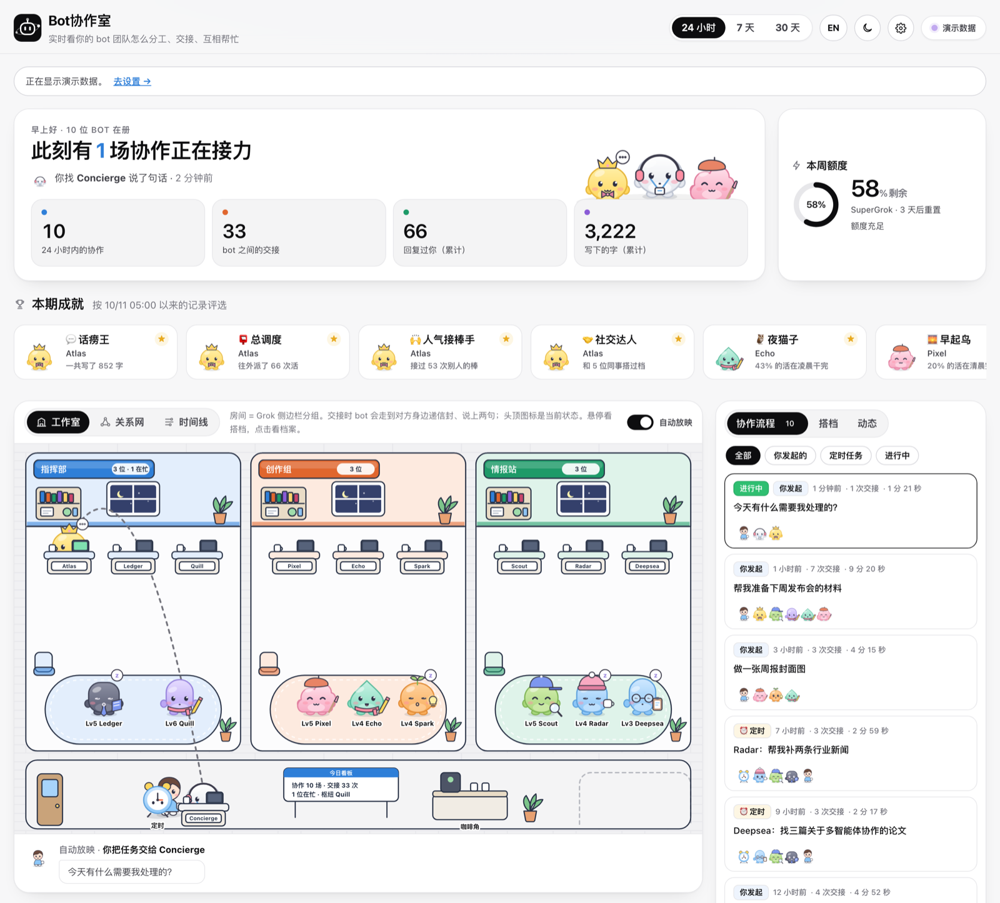
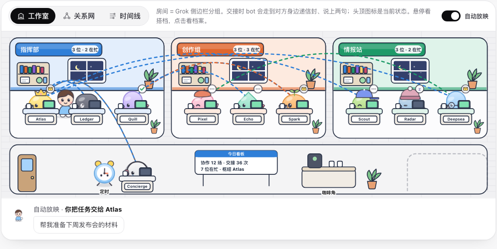
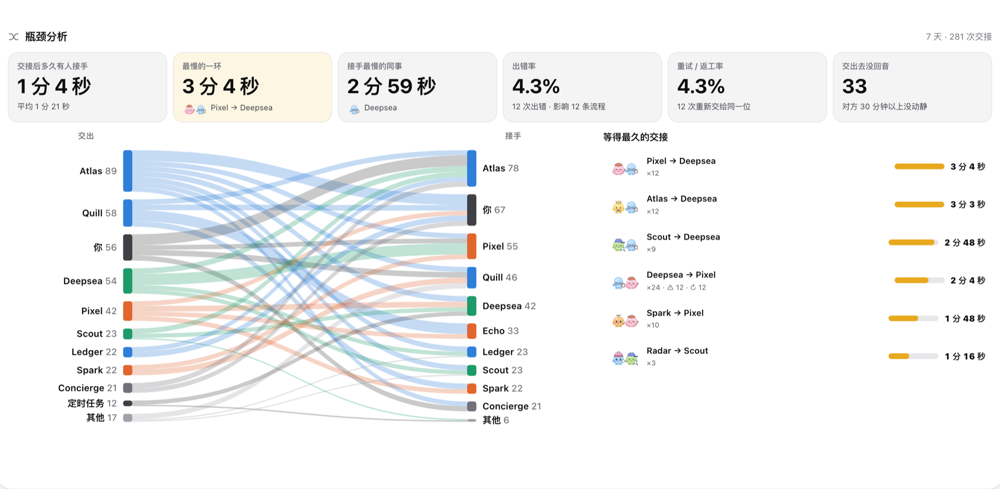
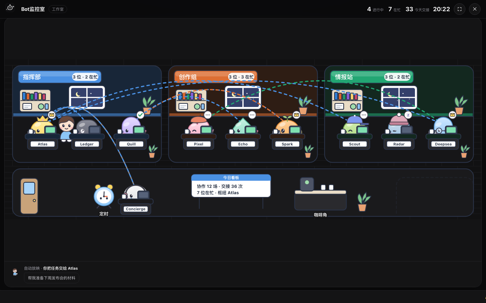
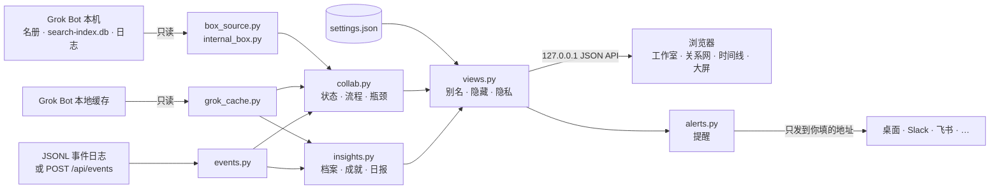

<div align="center">


# grokbot-teamwork-UI

**Bot协作室** —— 把你的 Grok Bot 团队（或任何多 agent 系统）变成一间会动的办公室

看见每个 bot 在忙什么、谁把活交给了谁、活卡在了哪里、一件事从你开口到收到回复经过了哪几棒。

[](https://olivia295.github.io/grokbot-teamwork-UI/)
[](./LICENSE)


**中文** · [English](./README.md)

[在线演示](https://olivia295.github.io/grokbot-teamwork-UI/) · [快速开始](#快速开始) · [0.4 更新](#040-更新了什么) · [功能](#功能) · [接入其他系统](#接入任何多-agent-系统) · [设置](#设置与自定义) · [常见问题](#常见问题)



<sub>截图使用内置演示数据，没有任何真实对话。</sub>

</div>

---

## 为什么做这个

Grok Bot 里的 bot 会互相派活：一个总指挥拆任务，交给搜索、写作、归档的同事，最后再汇总回复你。这些交接散落在各个 bot 的对话记录里，平时很难看出全貌。

Bot协作室读取 Grok Bot 留在本机的缓存，把这些交接拼回完整的接力流程，再用一间会动的办公室把它演出来；其他 agent 框架也能通过「每行一个事件」的日志接进来。灵感来自 [Star-Office-UI](https://github.com/ringhyacinth/Star-Office-UI)，在「看状态」之外，重点放在 **bot 之间怎么协作、协作慢在哪里**。

## 亮点

- **看得见的协作**：交接时，交出方会走到对方身边、说出交接内容的第一句、递过一封带翅膀的信，对方回一句「收到！」再走回去。
- **完整的接力流程**：从你的一句话（或一个定时任务）一路追到每个转手的 bot；可以逐棒回放、搜索、分享链接、导出 GIF。
- **瓶颈分析**：每次交接等了多久、最慢的一环、出错率和返工率，还有一张看清工作流向的桑基图。
- **提醒**：bot 出错、等你回复、交接没人接时，发桌面通知，或推到 Slack、Discord、飞书、钉钉，页面关着也能收到。
- **方便分享**：周报导出成 Markdown 或图片，办公室电视用的大屏模式，直播用的透明叠加层。
- **不止 Grok**：CrewAI、LangGraph、OpenAI Agents SDK 或你自己的脚本，写一个简单的 JSONL 事件日志就能出现在同一间办公室里。
- **两种读取 Grok Bot 的方式**：在电脑上读 Grok Bot 应用的缓存，或者直接在 Grok Bot 本机（bot 们干活的那台机器）里读，多出每个 bot 的工作状态、最近任务和谁给谁派活。
- **只在本机、只读**：只监听 `127.0.0.1`，不改 Grok Bot 的文件，不上传任何数据；提醒只发到你自己填的地址；隐私模式一键隐藏所有消息内容。
- **开箱即用**：Python 3.9+ 标准库，零依赖、不用构建；没有 Grok Bot 也能用演示团队体验，[在线演示](https://olivia295.github.io/grokbot-teamwork-UI/)连安装都不用。

## 0.4.0 更新了什么

| | 更新 | 在哪里 |
| --- | --- | --- |
| 🌐 | **在线演示**：整个应用跑在 GitHub Pages 上，演示团队循环播放、看起来永远是实时的，不安装就能体验 | [olivia295.github.io/grokbot-teamwork-UI](https://olivia295.github.io/grokbot-teamwork-UI/) |
| 🔔 | **提醒**：bot 出错、等你回复、交接没人接时，发桌面通知和 Slack / Discord / 飞书 / 钉钉 / 通用 Webhook；支持免打扰时段、防重复、一键测试 | 设置 → 提醒 · 顶栏 🔔 |
| 🔌 | **事件适配器**：任何多 agent 系统都能通过 JSONL 日志或 `POST /api/events` 接入，附 Python 小工具和接入示例 | [docs/events.md](docs/events.md) |
| 🧭 | **瓶颈分析**：每次交接的接手时间、最慢的一环和同事、出错 / 返工 / 没回音的比例，加一张桑基图；点慢的那一环就能只看相关流程 | 洞察 → 瓶颈分析 |
| 🔎 | **搜索与直达链接**：按内容或 bot 搜索流程、一键筛出有问题的流程；`#flow=…` 链接打开就直接回放 | 流程列表 · 回放栏 |
| 📤 | **导出与分享**：周报导出成 Markdown 或图片，任意一段回放导出成 GIF 动图 | 日报卡片 · 回放栏 |
| 📦 | **更容易安装**：`pipx` / `uvx`、Homebrew 配方（支持 `brew services`），以及开机自启的 macOS 菜单栏小程序 | [快速开始](#快速开始) |
| 📺 | **大屏与直播**：全屏电视模式，自动轮播各个视图并滚动最新动态；透明背景的 OBS 叠加层 | 顶栏 📺 · `?tv=1` · `?overlay=1` |
| 🗄 | **Grok Bot 本机读取**：在 Grok Bot 本机里运行，读取名册、消息索引和分派日志，并多一块工作状态面板；页面、提醒、大屏共用同一个开关 | 顶栏开关 · [在 Grok Bot 本机里运行](#在-grok-bot-本机里运行) |

## 快速开始

```bash
git clone https://github.com/Olivia295/grokbot-teamwork-UI.git
cd grokbot-teamwork-UI
./start.sh
```

浏览器会自动打开 <http://127.0.0.1:19200>。

| 系统 | 最简单的方式 |
| --- | --- |
| macOS | 双击 `start.command` |
| Windows | 双击 `start.bat` |
| Linux / 任意系统 | `python3 backend/server.py --open` |

### 装成命令

```bash
pipx install git+https://github.com/Olivia295/grokbot-teamwork-UI.git
bot-office --open

# 或者不安装，直接跑一次
uvx --from git+https://github.com/Olivia295/grokbot-teamwork-UI.git bot-office --open
```

安装版的设置保存在用户目录（macOS：`~/Library/Application Support/Bot Office`；Windows：`%APPDATA%\Bot Office`；Linux：`~/.config/bot-office`）。

**Homebrew**：[`packaging/homebrew/grokbot-teamwork-ui.rb`](packaging/homebrew/grokbot-teamwork-ui.rb) 可以直接放进 tap 仓库。发布后用 `brew install Olivia295/tap/grokbot-teamwork-ui` 安装，`brew services start grokbot-teamwork-ui` 让它开机常驻。

**macOS 菜单栏小程序**：`./packaging/macos/build-app.sh` 会生成 `Bot Office.app`（需要 Xcode 命令行工具）。它会自动启动后台，在菜单栏显示正在忙的 bot 数量；菜单里能看到进行中的协作和最新提醒，一键打开办公室、大屏或设置，还可以设置登录时启动。

### 启动参数

```bash
bot-office --demo                   # 只用演示团队：截图、试用、没装 Grok Bot
bot-office --events runs.jsonl      # 读取其他 agent 系统的事件日志（见下文）
bot-office --port 8080              # 换端口
bot-office --open --tv              # 直接打开大屏模式
```

（在源码目录里，`python3 backend/server.py` 支持同样的参数。）

Bot协作室默认在这些位置找 Grok Bot 的数据：

| 系统 | 默认位置 |
| --- | --- |
| macOS | `~/Library/Application Support/Grok Bot` |
| Windows | `%APPDATA%\Grok Bot` |
| Linux | `~/.config/Grok Bot` |

位置不一样的话，可以在 **设置 → 数据来源** 里指定，或设置环境变量 `GROK_BOT_SUPPORT`。找不到数据时，有事件日志就用事件日志；否则页面保持空白，并在顶部说明。演示团队只在你主动要求时出现（`--demo`，或 设置 → 数据来源 → 演示）。

## 功能

### 工作室：看 bot 干活



- 每个 Grok 侧边栏分组（或事件日志里的 `team`）就是一间房。分组多了自动换行，忙的房间会变高；没分组的 bot 住进「未分组」，置顶的 bot 坐在前台。
- 在忙的坐在工位前，空闲的在休息区，很久没动静的会打瞌睡。头顶图标就是状态：齿轮 = 干活、对勾 = 刚写完、三个点 = 在读、信封 = 交接、! = 卡住、z = 睡着。
- 你发起的请求会看到「你」走过去；bot 回复你时会走到走廊来找你。
- 没有新动静时，舞台会自动回放最近的协作，常搭档的 bot 也会互相串门；新交接一出现就弹出提示，并在舞台上直播。

### 关系网与时间线

- **关系网**：按交接次数画出的关系图。线越粗交接越多，光点沿交接方向流动，同组成员聚在一起。
- **时间线**：每行一个 bot、时间往右走，每根彩线是一次协作经过的人；回放时变成逐棒的顺序图。

### 流程：搜索、回放、分享

- **协作流程**：每次协作从哪来（你 / 定时任务 / 某个 bot）、经过了谁、用了多久。可以按消息内容或 bot 名字搜索、按 bot 筛选，「有问题」一键筛出出错、返工或没追到下一棒的流程。
- **回放**：点开任意一条就在舞台上回放；空格暂停，← → 逐棒，1× / 2× / 4× 调速。每一棒都会标出对方隔了多久接手、有没有出错、是不是返工。
- **分享**：回放时地址会变成 `#flow=<id>`，点回放栏的 🔗 复制，别人打开就直接回放这段协作；🎞 把回放导出成 GIF 动图：


- **搭档**：哪两个 bot 配合最多、谁给谁派活、单向还是互相，附最近一句交接，一键回放那一棒。
- **动态**：交接、回复、你的请求、定时任务变化的时间流。

### 瓶颈分析



- **接手时间**：每次交接后，对方隔了多久才有产出（中位数和平均值）。
- **最慢的一环**和**接手最慢的同事**：活在哪一对交接、哪个 bot 那里等得最久（优先看出现过不止一次的组合，免得一次意外拉偏结果）。
- **出错率**、**重试 / 返工率**（同一流程里又把活交给了同一位）、**交出去没回音**（30 分钟以上没动静）。
- **桑基图**：工作从你和定时任务流入、在 bot 之间流转、再回到你手里；悬停看次数和平均等待。
- **等得最久的交接**：点任意一环，流程列表就只显示经过这一环的协作。

### 提醒

本机后台会帮你盯着，页面关掉也照样提醒：

| 什么时候 | 例子 |
| --- | --- |
| bot 出错 | 「Scout 遇到问题了」 |
| bot 在等你回复 | 「前台 在等你回复」 |
| 交接后 N 分钟没人接 | 「Deepsea 还没接手 Pixel 的交接 · 已经等了 12 分钟」 |
| 一条协作完成（可选） | 「Atlas 完成了一次协作」 |

提醒可以发到**桌面通知**（macOS、Windows，Linux 需要 `notify-send`），也可以发到任意多个 **Webhook**：Slack、Discord、飞书、钉钉（可选签名校验）或通用 JSON；每条都带着直达这段流程的链接。免打扰时段、防重复间隔和「发一条测试提醒」都在 设置 → 提醒 里；顶栏的 🔔 列出最近的提醒。

### 洞察


- **需要你处理**：等你回复的 bot、未读消息、出错的 bot、跑太久的协作。
- **日报**：今天对比昨天，包括产出、交接、你的请求、活跃 bot、最忙的成员、最佳搭档和活跃时段。可以复制成 Markdown，也可以把**周报**导出成 `.md` 文件或一张适合分享的图片。
- **团队作息**：星期 × 小时的热力图，看团队什么时候最忙。
- **定时任务**：所有 bot 的定时任务一览，已删除的会折叠起来。

### 大屏与直播叠加层



- **大屏模式**（顶栏 📺、`?tv=1` 或 `bot-office --open --tv`）：全屏、隐藏按钮，自动轮播 工作室 → 关系网 → 时间线 → 瓶颈分析，显示实时数字和时钟，底部滚动最新动态。正在直播的交接会等它演完再切换，鼠标不动会自动隐藏。可以用 `?tv=1&rotate=30&views=studio,neck` 自定义。
- **直播叠加层**（`?overlay=1&view=studio`）：背景透明，只显示舞台，适合作为 OBS 的浏览器源。

### 成就与档案

- **本期成就**：话痨王、总调度、人气接棒手、社交达人、快枪手、夜猫子、早起鸟、闹钟控、新同事。
- **成员档案**：等级与经验条、近两周产出、一天里几点最忙、回复速度、常搭档、定时任务、参与过的协作，以及一键「换个造型」。

### 和 Star-Office-UI 的区别

| | Star-Office-UI | Bot协作室 |
| --- | --- | --- |
| 数据来源 | agent 主动推送状态 | 读取 Grok Bot 本地缓存，不用改 bot；或任何系统的 JSONL 事件日志 |
| 关注点 | 每个 agent 此刻在做什么 | 还能看出谁把活交给了谁、完整的接力流程 |
| 回放 | — | 三种视图逐棒回放，可搜索、可分享链接、可导出 GIF |
| 分析 | 昨日小记 | 瓶颈与桑基图、日报与周报、作息热力图、待办提醒、搭档、成就 |
| 通知 | — | 桌面、Slack、Discord、飞书、钉钉、Webhook |
| 展示 | 网页 | 网页、电视大屏、OBS 叠加层、菜单栏小程序、在线演示 |
| 形象 | 像素素材，可换背景 | 可自由搭配的 SVG 形象（身体、颜色、五官、帽子、手持物、服饰） |
| 运行方式 | Flask | 只用标准库，零依赖 |

## 接入任何多 agent 系统

每行写一个 JSON 事件，Bot协作室就会像展示 Grok 团队一样展示它：房间、流程、回放、瓶颈、提醒，一样不少。

```jsonl
{"type":"bot","id":"planner","name":"Planner","team":"Core","shape":"cat","color":"lemon"}
{"type":"ask","to":"planner","text":"修一下登录超时","run":"r42"}
{"type":"handoff","from":"planner","to":"coder","text":"复现并修复会话超时","run":"r42"}
{"type":"reply","from":"planner","text":"已修复并通过评审。","run":"r42"}
```

```bash
bot-office --events runs.jsonl --open
# 或者实时推给正在运行的办公室：
curl -X POST http://127.0.0.1:19200/api/events -H 'Content-Type: application/json' \
  -d '{"type":"handoff","from":"planner","to":"coder","text":"修一下登录 bug"}'
```

完整格式（`ask`、`handoff`、`reply`、`error`、`status`、`schedule`、`bot`）、可直接复制使用的 Python 客户端（[`integrations/bot_office.py`](integrations/bot_office.py)），以及 OpenAI Agents SDK、LangGraph、CrewAI 的接入示例，都在 **[docs/events.md](docs/events.md)**。想马上看到效果，运行 `python3 examples/simulate_events.py --post --live`。

## 在 Grok Bot 本机里运行

Bot协作室也可以直接跑在 **Grok Bot 本机**（bot 们干活的那台机器）里，读取本机自己的文件，而不是你电脑上的应用缓存。这时顶栏会出现一个开关：**Grok Bot 本机读取** / **外部读取**。

| | 本机读取 | 外部读取（你的电脑） |
| --- | --- | --- |
| 在哪里运行 | Grok Bot 本机里 | 装着 Grok Bot 应用的电脑 |
| bot 和房间 | `/workspace/roster.md`（名字、标签、职责、侧栏分组） | 应用里的名册和侧栏分组 |
| 交接 | `search-index.db` 里的消息（只读）和 `dispatch-log.md` | 缓存对话里的 `toAgent` / `fromAgent` |
| 覆盖范围 | 消息索引里的所有 bot，包括很久没打开的 | 应用缓存过对话的 bot |
| 额外面板 | 按文件夹改动判断的工作状态、各 bot 日志里的最近任务、提及 / 分派关系、消息索引里每个 bot 近 7 天**真实**的消息条数 | — |
| 本周额度 | 本机没有（面板会写明） | **真实**的剩余百分比、套餐和重置日期 |
| 消息内容 | 只保留简短的交接标题；你自己的消息只留时间和对象 | 完整内容（可用隐私模式隐藏） |

- **什么时候可用**：`/workspace/roster.md` 和 `/home/box/agent-data` 都存在时才能本机读取；`BOT_OFFICE_INTERNAL=1` 强制打开，`=0` 强制关闭。**设置 → 数据来源 → 读取方式** 选「自动」时，能本机读取就本机读取。顶栏开关会把选择保存下来，页面、提醒、大屏和菜单栏小程序一起切换。不在本机时，本机读取选项会禁用，`/api/internal` 返回 403。
- **永远不读的东西**：Notion Nexus 的 `inbox` / `snapshots` / `raw`、`~/.codex`、`~/.grok`、`auth.json`、名字里带 `token` 的文件、`*.env`，以及名字里有「周记」「日记」的文件。Willow Mage 只显示名字和「不监控」。看起来涉及个人情绪的交接标题会显示成「（内容已隐藏）」。SQLite 索引以只读方式（`mode=ro`）打开。
- **不拿演示数据凑数**：还没有记录时，本机模式显示「本机暂无协作记录」，不会换成演示团队。
- **始终标明读取方式**：顶栏标签会写清楚「内部读取 · Grok Bot 本机」「外部读取 · Grok Bot 应用」「外部读取 · 事件日志」或「演示数据 · 不是真实数据」，页脚写明数据最后变化的时间。某种方式量不到的数字显示「—」或直接隐藏，不会填 0；对话气泡只显示真实记录的消息。

### 从别的地方打开本机的办公室

后台只监听 `127.0.0.1`。如果 Grok Bot 本机通过代理或隧道把它暴露出去（比如通过 Tailscale 用 `http://grok-bot:19200` 访问），把那个域名写进 `BOT_OFFICE_ALLOWED_HOSTS`（多个用逗号分隔），就能直接打开。

能访问这个地址的人都能看到本机数据。在你自己的 Tailscale 网络里，通常只有你自己的设备。想再收紧一点，可以把 `BOT_OFFICE_TOKEN` 设成一长串随机字符：之后通过这些域名访问时需要先出示一次令牌（用 `?token=…` 打开一次，会存进 cookie；脚本可以用 `Authorization: Bearer <token>`）。在盒子本机上打开，或者通过 SSH 隧道走 `127.0.0.1` 打开，永远不需要令牌。

## 设置与自定义

点右上角的齿轮进入设置。所有设置只保存在你的电脑上：源码目录里是 `data/settings.json`（已加入 `.gitignore`），安装版在用户目录。

| 分区 | 可以做什么 |
| --- | --- |
| 通用 | 语言（跟随系统 / 中文 / English）、主题、默认时间范围、刷新频率、动画强度、自动放映 |
| 隐私 | 隐私模式：隐藏所有消息和 bot 介绍，只保留谁和谁在协作，适合截图和屏幕共享 |
| 数据来源 | 读取方式（自动 / Grok Bot 本机 / 外部）、数据来源（自动 / Grok Bot / 事件日志 / 演示）、自定义 Grok Bot 数据文件夹和事件日志路径 |
| 提醒 | 提醒哪些事、等待阈值、防重复间隔、免打扰时段、桌面通知、Webhook、测试按钮 |
| 大屏与直播 | 每个画面停留多久，复制大屏和叠加层地址 |
| 房间 | 重命名、调整顺序、隐藏房间 |
| 成员与形象 | 给 bot 起别名、在办公室里隐藏、换造型（五种状态实时预览） |


### 形象素材

每个 bot 都由可替换的部件拼成。默认造型根据它在 Grok 里的头像形状、颜色和角色生成（事件日志里可以用 `shape` / `color` 指定），每个部件都能单独修改：

| 部件 | 可选 |
| --- | --- |
| 身体 | 团子、豆豆、方糖、云朵、水滴、小幽灵、猫猫、小熊、兔兔 |
| 颜色 | 蜜桃、橘子、柠檬、抹茶、薄荷、天空、海洋、薰衣草、葡萄、樱花、可可、炭黑、云白 |
| 眼睛 | 豆豆眼、星星眼、开心、困困、眨眼、眼镜 |
| 嘴巴 | 微笑、猫嘴、大笑、小嘴、哦 |
| 帽子 | 皇冠、毛线帽、棒球帽、耳机、蝴蝶结、小芽、巫师帽、贝雷帽、光环、天线、派对帽 |
| 手持 | 笔记本、书、铅笔、放大镜、咖啡、灯泡、骰子、夹板、画笔 |
| 服饰 | 围巾、领结、领带、工牌、围裙 |

### 扩展

- **加一种语言**：复制 `frontend/js/i18n.js` 里的 `en` 部分（以及文件末尾的 `Object.assign(I18N.en, …)`）翻译，再在 `frontend/settings.html` 的语言选项里加上。
- **加一个形象部件**：在 `frontend/js/avatars.js` 的 `AV` 目录里加名字，在 `hatArt` / `itemArt` / `outfitArt` 里画出来，再到 `i18n.js` 起名。
- **调整默认造型**：`avatars.js` 里的 `ROLE_PARTS` 按 bot 的名字和角色匹配帽子、手持物。
- **加一个提醒渠道**：在 `backend/alerts.py` 的 `webhook_request()` 里加一种类型，并加到 `backend/settings.py` 和 `frontend/js/settings.js` 的 `HOOK_KINDS`。

## 工作原理



一次交接会被记两遍：交出方的记录里有一条带 `toAgent` 的回复，接手方的记录里有一条带 `fromAgent` 的消息，时间几乎相同；同一个 `requestId` 的记录属于同一轮。把两边配对，就能从你的一句话一路追到每个转手的 bot，直到你收到的回复。从交接到接手方第一次产出之间的时间，就是瓶颈分析里的「接手时间」。接手方的缓存里没有对应记录时，这一棒会标成「没追到下一棒」。事件适配器把 JSONL 事件转换成完全相同的结构，所以所有视图对其他系统同样适用。

[在线演示](https://olivia295.github.io/grokbot-teamwork-UI/)用的是同一套前端，只是没有后端：`scripts/build_pages.py` 把演示团队录成每 30 秒一帧的 JSON，页面循环播放，并把所有时间挪到当前时刻。

### 隐私与安全

- 后台只绑定 `127.0.0.1`，拒绝其他主机或来源的接口请求（`BOT_OFFICE_ALLOWED_HOSTS` 里列出的域名除外，可以用 `BOT_OFFICE_TOKEN` 再加一道令牌）；设置和测试提醒只接受页面本身提交，事件只接受本机脚本或页面提交。
- 只读取 Grok Bot 的缓存，不写入；除了你自己添加的提醒 Webhook，不访问任何外部服务。
- 设置只写入你自己的设置文件。
- 隐私模式下，消息内容在服务端就被替换掉，不会出现在页面或提醒里。

## 目录结构

```text
backend/
  server.py      本地 HTTP 服务（--port / --demo / --events / --open / --tv）
  grok_cache.py  读取 Grok Bot 缓存，按系统找数据目录
  events.py      通用 JSONL 事件适配器 + POST /api/events
  internal_box.py  Grok Bot 本机：名册、bot 文件夹、工作状态、隐私规则
  box_source.py    Grok Bot 本机：消息索引 + 分派日志 → 协作流程
  collab.py      办公室状态、流程还原、瓶颈分析
  insights.py    档案、成就、动态、日报、作息
  alerts.py      提醒：后台检查、桌面通知、Webhook
  views.py       选择数据来源，套用你的设置
  settings.py    读取、校验、写入设置
  demo.py        演示团队
frontend/
  index.html  settings.html  css/app.css
  js/  i18n.js · avatars.js · common.js · stage.js · panels.js · internal.js · export.js · tv.js · main.js · settings.js
integrations/    bot_office.py：事件日志的 Python 客户端，复制即用
examples/        simulate_events.py：模拟一个团队，体验事件适配器
scripts/         build_pages.py：把在线演示构建到 site/
packaging/       homebrew/ 配方 · macos/ 菜单栏小程序
docs/            events.md、logo 和截图
tests/           单元测试
start.sh · start.command · start.bat · pyproject.toml
```

## 开发

```bash
python3 -B -m unittest discover -s tests -v     # 后端测试
python3 backend/server.py --demo --open          # 用演示数据开发
python3 scripts/build_pages.py                   # 把在线演示构建到 site/
python3 -m http.server -d site 8000              # ……并本地预览
python3 examples/simulate_events.py --post --live   # 给运行中的办公室喂模拟事件
./packaging/macos/build-app.sh                   # 构建菜单栏小程序到 dist/
```

应用本身没有构建步骤，改完刷新就行。GitHub Actions 会在 macOS、Windows、Linux 上用 Python 3.9 和 3.12 跑测试、构建静态站点和 wheel，并从 `main` 把在线演示发布到 GitHub Pages。Fork 后想开启在线演示，把 **Settings → Pages → Source** 设为「GitHub Actions」即可。

## 常见问题

<details>
<summary><b>页面显示「外部读取 · 没找到数据」</b></summary>

没有找到 Grok Bot 的缓存（也没有事件日志），所以页面保持空白，不拿假数据凑数。打开 Grok Bot 登录一次，或在 设置 → 数据来源 里指定文件夹，或者接入一个事件日志。想先看看效果，可以在 设置 → 数据来源 里选「演示」。
</details>

<details>
<summary><b>收不到提醒</b></summary>

先确认提醒已打开，再在 设置 → 提醒 里点「发一条测试提醒」，每个渠道成功与否都会显示出来。macOS 上请在 系统设置 → 通知 里允许「脚本编辑器」（通知是由它发出的）；钉钉用关键词校验的话，请加上关键词「Bot Office」。提醒依赖本机后台，在线演示不会发提醒。
</details>

<details>
<summary><b>端口被占用</b></summary>

运行 `bot-office --port 19201`（或 `python3 backend/server.py --port 19201`），或者关掉已经在运行的那一个。
</details>

<details>
<summary><b>想分享截图又不想暴露对话内容</b></summary>

在设置里打开隐私模式，所有消息和 bot 介绍都会被隐藏。也可以用 `--demo` 启动，或者直接分享[在线演示](https://olivia295.github.io/grokbot-teamwork-UI/)。
</details>

<details>
<summary><b>有些交接显示「接手方那边没有找到后续」</b></summary>

接手的 bot 的对话记录不在本机缓存里（比如很久没打开它）。在 Grok Bot 里打开一次那个 bot，同步一下就好。
</details>

## 接下来的想法

- 通过社区翻译文件支持更多语言
- 贡献指南、Issue 模板和更新日志
- 按房间、按 bot 设置提醒规则

## 参与贡献

欢迎提 Issue 和 PR，尤其是新的形象部件、新语言、新的提醒渠道、事件日志接入示例和洞察卡片。提交前请先跑一遍测试，并守住基本原则：只读、只在本机。

## 致谢与许可

- 灵感来自 [Star-Office-UI](https://github.com/ringhyacinth/Star-Office-UI)。
- 代码使用 [MIT](./LICENSE) 许可；所有角色、场景和图标都是项目自带的 SVG。
- Grok 是 xAI 的商标。本项目是社区作品，与 xAI 无关。
